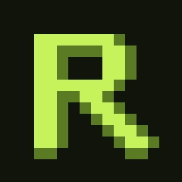
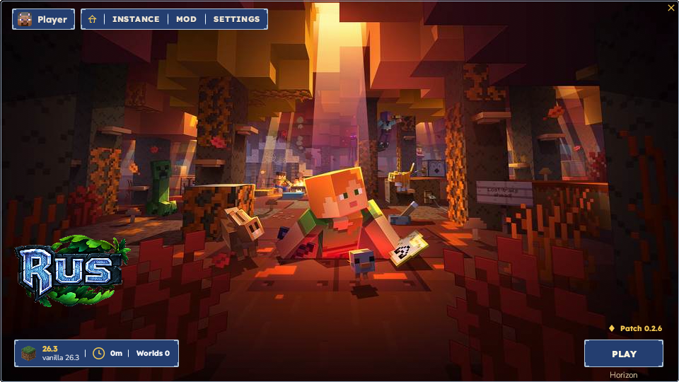
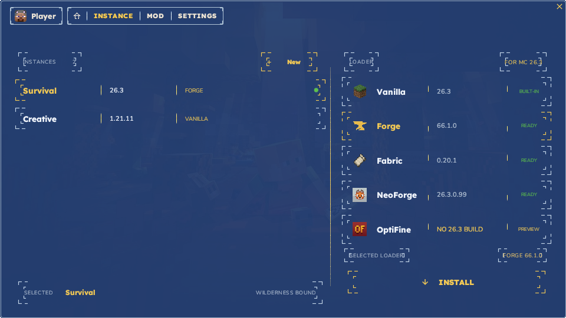
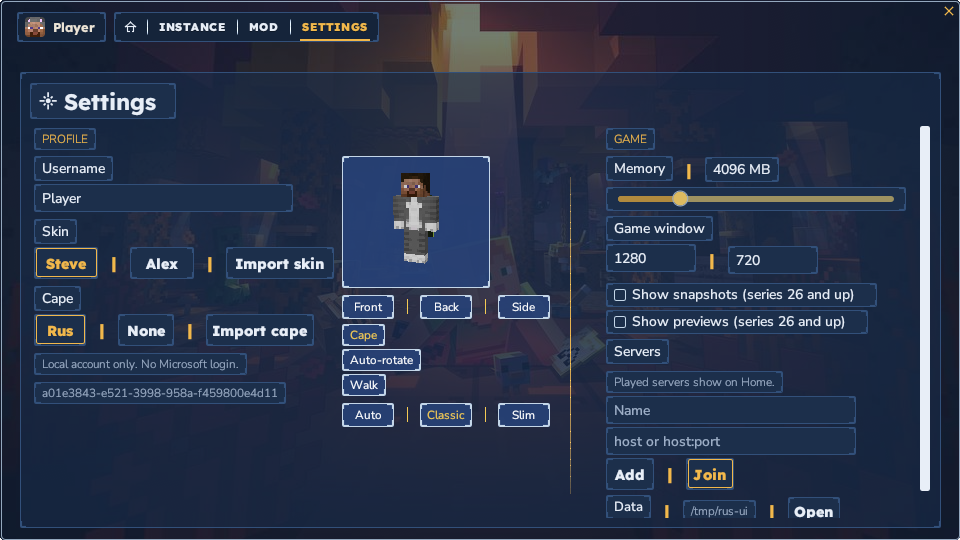
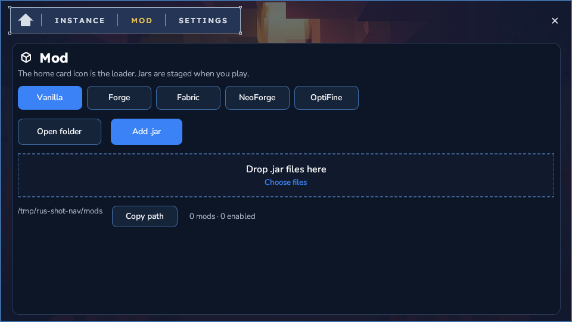

<p align="center">
  
</p>

<h1 align="center">Rus</h1>

<p align="center">
  <b>A native Minecraft: Java Edition launcher, written in Rust.</b>
</p>

<p align="center">
  Four tabs over the official collection wallpaper, a local account, and a 3D skin preview.<br>
  Rus is its own window. No title bar, no browser, no local page. Exit is a button in the app.<br>
  <i>Not affiliated with Mojang or Microsoft.</i>
</p>

<p align="center">
  
  
  
  
</p>

<p align="center">
  <a href="https://github.com/obsifox/rus/releases/latest"><b>Download</b></a> ·
  <a href="#a-tour">A tour</a> ·
  <a href="#why-rus">Why Rus</a> ·
  <a href="#what-it-does">What it does</a> ·
  <a href="#architecture">Architecture</a> ·
  <a href="#downloads">Downloads</a>
</p>

<br>

<p align="center">
  
  <br><sub><b>Home.</b> The selected version’s official wallpaper fills the window. Play sits on the art.</sub>
</p>

## A tour

These pictures are the Rus window itself, captured from the native program (`rus --shot`).

<table>
<tr>
<td width="50%" valign="top"><p align="center"><sub><b>Instance.</b> Several isolated copies of one version. New is an overlay, not a separate window.</sub></p></td>
<td width="50%" valign="top"><p align="center"><sub><b>Settings.</b> Local username, memory, window, and a 3D skin preview. No Microsoft login.</sub></p></td>
</tr>
<tr>
<td colspan="2"><p align="center"><sub><b>Mods.</b> Drop a .jar, or add one from disk. Enabled ones are staged when you play.</sub></p></td>
</tr>
</table>

## Why Rus

- **A window, not a page.** Native [egui](https://github.com/emilk/egui), with the system title bar removed. The window is a fixed 960×540. Exit sits in the app.
- **Your account stays local.** Username, Steve or Alex, and the Rus cape. The offline UUID is the vanilla one (`OfflinePlayer:<name>`).
- **The collection is in the launcher.** Each version shows the official wallpaper for its drop, compressed inside the binary from [minecraft.net/collectibles](https://www.minecraft.net/en-us/collectibles). No download at runtime.
- **Installs survive a dropped connection.** Downloads are 2 MB parts. A failed or corrupt part is fetched again. Finished parts stay.
- **The client is sandboxed.** On Linux, bubblewrap gives the game its own mount, pid and hostname (`rus-sandbox`). Your home directory is not mounted. On Windows the client sits in a job object with a private profile under Rus.
- **26.3 can start in Horizon.** The switch beside Play uses the unofficial [Horizon](https://github.com/ludovic111/horizon) client when you want it. Vanilla stays installed.

## What it does

| Area | What you get |
|---|---|
| **Window** | Home, Instance, Mod, Settings, over the collection wallpaper. English. Titles and tabs use Lexend; body and captions use Nunito Sans, the faces from hytale.com. Icons are [Material Symbols](https://fonts.google.com/icons). |
| **Account** | Local only. Default skin Steve. Import a PNG skin or cape. One sample cape, Rus, in the real 64×32 layout. A CPU 3D preview, classic or slim. |
| **Instances** | Several isolated worlds of one version. New is an overlay on the window. Version files stay shared. The home card is not a button. Snapshots and previews from series 26 stay hidden until Settings turns them on. |
| **Install** | Patches you can turn off before it starts: vanilla, assets, Java, skin, mods. Java is Adoptium Temurin. |
| **Play** | Vanilla Java client, or Horizon for 26.3. Both start outside the browser, inside the sandbox. |
| **Loaders** | Vanilla is built in. Forge, Fabric and NeoForge show the official build for the selected version, then Install fetches it. OptiFine stays a preview when that version has no build. |
| **Mods** | A folder of jars. Drop a `.jar` on the window, or add one from disk. Toggle, copy the path, or delete. Enabled ones are staged when you play. |

You need your own copy of Minecraft. Rus downloads it from Mojang into `~/.rus` on Linux, or `%APPDATA%\Rus` on Windows.

## Architecture

```
src/main.rs        native entry. no browser, no local page
src/instances.rs   isolated instance folders
src/desktop.rs     the window
src/wallpapers.rs  collection art, cached under the data folder
src/mojang.rs      version manifest
src/install.rs     patch pipeline
src/net.rs         part-by-part downloads
src/java.rs        Temurin JRE
src/skin.rs        offline skin pack, import, and the Rus cape
src/skinmodel.rs   classic and slim boxes, face avatar
src/raster.rs      CPU skin preview
src/preview3d.rs   drag, zoom, and walk
src/dialog.rs      native file picker and folder open
src/loaders.rs     Forge, Fabric, NeoForge and OptiFine builds
src/mods.rs        mod library
src/play.rs        Java command line
src/sandbox.rs     bubblewrap jail, or a Windows job object
src/horizon.rs     optional Horizon 26.3 client
```

| Flag | |
| --- | --- |
| `--dir <path>` | Data folder. Default `~/.rus`, or `%APPDATA%\Rus`. |
| `--help` | Short usage. |

## Build

Rust 1.80 or newer.

```bash
cargo build --release
./target/release/rus
```

Windows from Linux needs the MinGW linker and the `x86_64-pc-windows-gnu` target.

```bash
rustup target add x86_64-pc-windows-gnu
cargo build --release --target x86_64-pc-windows-gnu
```

Linux sandbox: `apt install bubblewrap`. Without it, the client still gets a private profile under the data folder.

## Downloads

| Platform | File |
| --- | --- |
| Linux x86-64 | [rus-linux-x86_64](https://github.com/obsifox/rus/releases/download/0.2.18/rus-linux-x86_64) |
| Windows x64 | [rus-windows-x64.exe](https://github.com/obsifox/rus/releases/download/0.2.18/rus-windows-x64.exe) |

Linux:

```bash
chmod +x rus-linux-x86_64
./rus-linux-x86_64
```

Windows: run `rus-windows-x64.exe`. It opens the Rus window. It does not open a browser.

## License

MIT. See [LICENSE](LICENSE).

Lexend and Nunito Sans are the faces used on hytale.com, under the SIL Open Font License. Material Symbols are used under the Apache License 2.0. Collection wallpapers are compressed inside Rus. Minecraft is a trademark of Mojang. Horizon is an unofficial project.
